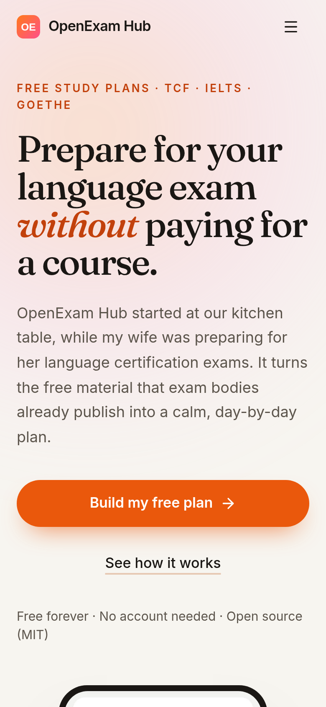
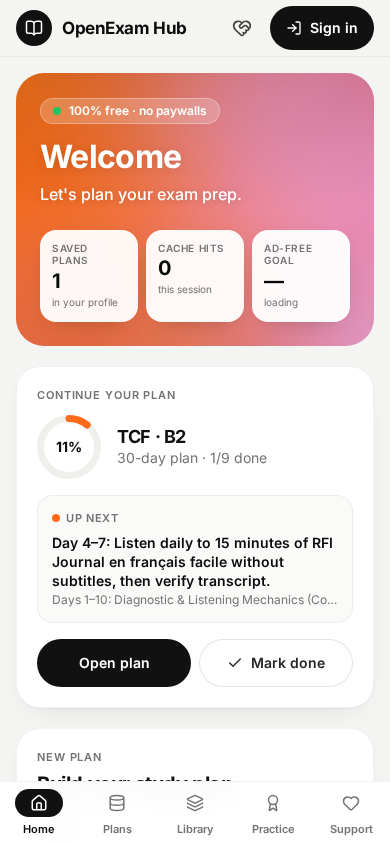
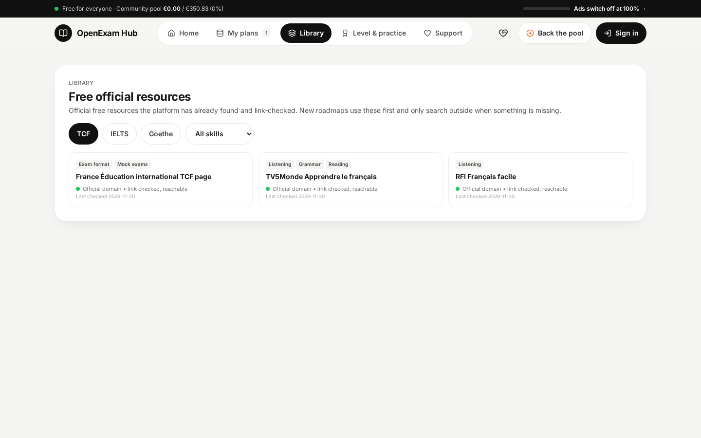

# OpenExam Hub

**Free study roadmaps for language exams, built from official free materials.**

[Live site](https://openexamhub.org) · [Fund this project (PayPal)](https://www.paypal.com/paypalme/JadissEL) · [Ko-fi](https://ko-fi.com/openexamhub) · License: [MIT](LICENSE)

OpenExam Hub turns the free material that exam boards and public broadcasters already publish into a calm, day-by-day study plan. Choose an exam, a target level and how many days you have. Every resource link is checked before you see it.

Free. Create a free account to generate your plan. A sample TEF Canada plan is available to preview first.

The planner currently covers **TEF Canada**, **TCF** (tout public and TCF Canada), **IELTS**, **TOEFL** iBT, **Goethe-Zertifikat** and **DELE** (levels A1–C2). More official-source exams are planned.

## Screenshots

| Landing | Planner |
|---|---|
|  |  |
|  |  |
|  | |

## Features

- **Day-by-day plans** from official exam-board and public-broadcaster sources, not paid courses.
- **Link-checked library.** Resources are stored with their official domain and a reachability check.
- **Placement self-check** (unofficial) and extra practice when you want a short diagnostic before you plan.
- **Progress coach** that can adjust the remaining days of a plan.
- **Free account to generate a plan.** An account (email or Google) is required so the AI token budget cannot be reused for repeat requests. A sample TEF Canada plan is available to preview first. You can export your plan as Markdown or JSON.
- **Funding transparency.** Free forever, funded openly by donations and a few dashboard ads (ads are not live yet). Income, expenses and a net balance are published on the [funding page](https://openexamhub.org/funding) and the signed-in Transparency tab. Ads come off once the next 5 years of running costs are covered.
- **Open source (MIT).**
- **Blog.** Guides at `/blog` for students, professionals and immigration applicants, built from Markdown in [`content/blog`](content/blog/README.md).

This is a study aid. It is not affiliated with CCI Paris / Le français des affaires, IRCC, France Éducation international, IELTS, ETS, the Goethe-Institut or Instituto Cervantes, and it is not an official placement test.

## Tech stack

- **Frontend:** Vite, React 18, Tailwind CSS 3
- **API:** Vercel serverless functions (Node 24)
- **Data:** Firebase Auth and Cloud Firestore
- **Planning:** a small algorithm layer (ranking, scheduling, FSRS-style spaced repetition, placement) plus an optional OpenAI-compatible LLM gateway

Deeper docs: [DEPLOY.md](DEPLOY.md) (environment, Firebase, webhooks), [CONTRACT.md](CONTRACT.md) (API), [ARCHITECTURE.md](ARCHITECTURE.md) (algorithms and data model).

## Quick start

You need Node.js 24.

```bash
npm install
npm run dev:api      # API on http://127.0.0.1:3001
npm run dev          # frontend on http://localhost:5173, /api proxied to :3001
```

`dev:api` needs either `FIRESTORE_EMULATOR_HOST` (see below) or a Firebase service account, plus optional `LLM_*` variables from [`.env.example`](.env.example). Secrets stay in the environment, never in the repo.

To explore the UI without a backend: `VITE_SERVER_ENABLED=false npm run dev`.

## Tests

```bash
npm test             # offline unit suites
npm run e2e          # Firestore emulator (project demo-openexam, needs Java 11+) + mock LLM
npm run build        # production frontend build into dist/
```

`npm run e2e` refuses any Firebase project id that does not start with `demo-`, so tests never touch production.

## Deploy

See [DEPLOY.md](DEPLOY.md) for the full checklist. In short: import this repo on Vercel, set the environment variables from `.env.example`, deploy Firestore rules and indexes, and add the production domain to Firebase Auth authorized domains.

## Blog

Articles live in [`content/blog`](content/blog/README.md) as Markdown files with a standard frontmatter block. The site lists them at `/blog`, prerenders each post for search engines, and adds them to `sitemap.xml` and `/blog/rss.xml` at build time. Drafts are visible on preview deploys and hidden in production.

To publish a post: add the file, open a pull request, set `draft: false` when it is ready, and merge. Vercel then deploys it automatically.

## Contributing

Contributions are welcome, including official-source exam resources, accessibility fixes and documentation. Please read [CONTRIBUTING.md](CONTRIBUTING.md) and the [Code of Conduct](CODE_OF_CONDUCT.md). Issues labelled [`good first issue`](https://github.com/JadissEL/openexam-hub/issues?q=is%3Aissue+is%3Aopen+label%3A%22good+first+issue%22) are a good place to start.

## Funding and ads

OpenExam Hub is free to use. Running costs are meant to be covered by donations and, until a publicly tracked funding goal is reached, by a few ads on the planner only.

- [PayPal](https://www.paypal.com/paypalme/JadissEL) — [Fund this project](https://www.paypal.com/paypalme/JadissEL). Keep OpenExam Hub free for every learner.
- [Ko-fi](https://ko-fi.com/openexamhub) (one-off tips)
- Open Collective (fiscal host application pending)
- GitHub Sponsors (pending; the Sponsors page is not live yet)

When the goal is met, the site is intended to become ad-free. Figures on the live site are the source of truth; this README does not invent earnings, expenses or user counts.

Public books live in two places:

- **Earnings** come from the server-written donation ledger (`treasury/monthly_ledger`) and, when ads are live, the AdSense total.
- **Expenses** are a reviewed list in [`src/expenses.js`](src/expenses.js). Add a new object when a real cost is paid (date, item, amount, currency, euro amount, source/receipt note). If the amount is not yet known, set `amount` / `amountEur` to `null` and `status` to `"pending"` — the site will show “amount pending” rather than a made-up figure. Recurring plans are listed at €0 only when they have been verified as free.
- **AI usage** is counted on the server from each provider response (prompt and completion tokens, no user data) into `stats/usage-{YYYY-MM}` and `stats/usage-total`. Costs are computed from the price table in [`lib/llmPricing.js`](lib/llmPricing.js). Free-tier calls are €0 but the token totals are still shown. `GET /api/stats` returns the public aggregates.

Net on the site is earnings minus recorded expenses minus lifetime AI cost.

## License

[MIT](LICENSE) © 2026 Jadiss EL ANTAKI

## Repository layout

| Path | What it is |
|---|---|
| `index.html`, `src/` | Vite + React frontend. The planner lives in `src/App.jsx`; the public landing page lives in `src/landing/`. |
| `api/` | Vercel serverless entrypoints. Route handlers live in `lib/routes/`; add new endpoints to a dispatcher, not as new `api/` files. |
| `lib/` | Server code: orchestrator, agents, LLM client, usage counters, library store, ledger, link checker, and `lib/algo/`. |
| `scripts/` | Unit suites, end-to-end test, mock LLM, local API server, library seeder. |
| `firestore.rules`, `firestore.indexes.json`, `firebase.json` | Firestore rules and indexes for the `openexam-hub` Firebase project. |
| `vercel.json` | Static build, functions, SPA rewrite, and scheduled crons. |
