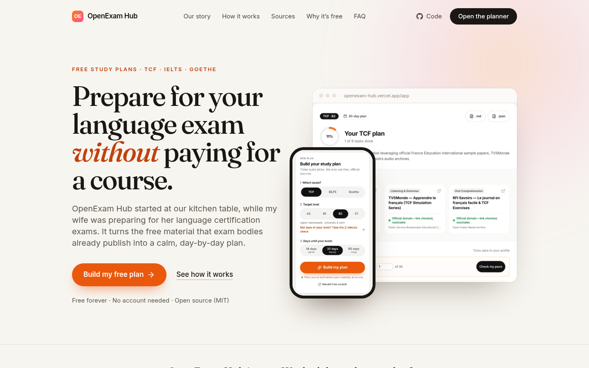
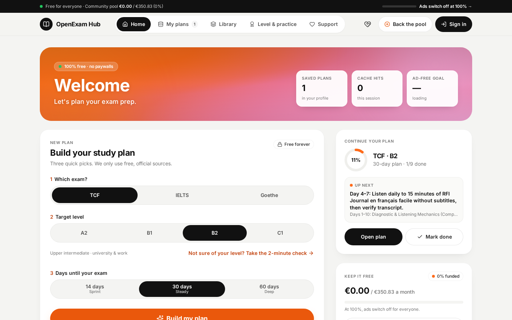

# OpenExam Hub

**Free study roadmaps for language exams, built from official free materials.**

[Live site](https://openexamhub.org) · [Ko-fi](https://ko-fi.com/openexamhub) · [Open Collective](https://opencollective.com/openexam-hub) · License: [MIT](LICENSE)

OpenExam Hub turns the free material that exam boards and public broadcasters already publish into a calm, day-by-day study plan. Choose an exam, a target level and how many days you have. Every resource link is checked before you see it.

No account is required. Sign in only if you want your plans to sync across devices.

The planner currently covers **TCF**, **IELTS** and **Goethe-Zertifikat** (levels A2–C1). More official-source exams are planned.

## Screenshots

| Landing | Planner |
|---|---|
|  |  |
|  |  |
|  | |

## Features

- **Day-by-day plans** from official exam-board and public-broadcaster sources, not paid courses.
- **Link-checked library.** Resources are stored with their official domain and a reachability check.
- **Placement self-check** (unofficial) and extra practice when you want a short diagnostic before you plan.
- **Progress coach** that can adjust the remaining days of a plan.
- **Guest by default.** Anonymous use is enough to build and download a plan as Markdown or JSON.
- **Funding transparency.** Donations and the ad-sunset threshold are shown on the site. A small number of ads may appear on the planner (never on the public landing page) until that goal is met; then ads switch off for everyone.
- **Open source (MIT).**

This is a study aid. It is not affiliated with France Éducation international, IELTS or the Goethe-Institut, and it is not an official placement test.

## Tech stack

- **Frontend:** Vite, React 18, Tailwind CSS 3
- **API:** Vercel serverless functions (Node 24)
- **Data:** Firebase Auth and Cloud Firestore
- **Planning:** a small algorithm layer (ranking, scheduling, FSRS-style spaced repetition, placement) plus an optional OpenAI-compatible LLM gateway

Deeper docs: [DEPLOY.md](DEPLOY.md) (environment, Firebase, webhooks), [CONTRACT.md](CONTRACT.md) (API), [ARCHITECTURE.md](ARCHITECTURE.md) (algorithms and data model).

## Quick start

You need Node.js 24.

```bash
npm install
npm run dev:api      # API on http://127.0.0.1:3001
npm run dev          # frontend on http://localhost:5173, /api proxied to :3001
```

`dev:api` needs either `FIRESTORE_EMULATOR_HOST` (see below) or a Firebase service account, plus optional `LLM_*` variables from [`.env.example`](.env.example). Secrets stay in the environment, never in the repo.

To explore the UI without a backend: `VITE_SERVER_ENABLED=false npm run dev`.

## Tests

```bash
npm test             # offline unit suites
npm run e2e          # Firestore emulator (project demo-openexam, needs Java 11+) + mock LLM
npm run build        # production frontend build into dist/
```

`npm run e2e` refuses any Firebase project id that does not start with `demo-`, so tests never touch production.

## Deploy

See [DEPLOY.md](DEPLOY.md) for the full checklist. In short: import this repo on Vercel, set the environment variables from `.env.example`, deploy Firestore rules and indexes, and add the production domain to Firebase Auth authorized domains.

## Contributing

Contributions are welcome, including official-source exam resources, accessibility fixes and documentation. Please read [CONTRIBUTING.md](CONTRIBUTING.md) and the [Code of Conduct](CODE_OF_CONDUCT.md). Issues labelled [`good first issue`](https://github.com/JadissEL/openexam-hub/issues?q=is%3Aissue+is%3Aopen+label%3A%22good+first+issue%22) are a good place to start.

## Funding and ads

OpenExam Hub is free to use. Running costs are meant to be covered by donations and, until a publicly tracked funding goal is reached, by a few ads on the planner only.

- [Ko-fi](https://ko-fi.com/openexamhub) (one-off tips)
- [Open Collective](https://opencollective.com/openexam-hub) (fiscal host application pending)
- GitHub Sponsors (pending, after the fiscal host on the Sponsors profile is corrected)

When the goal is met, the site is intended to become ad-free. Figures on the live site are the source of truth; this README does not invent earnings or user counts.

## License

[MIT](LICENSE) © 2026 Jadiss EL ANTAKI

## Repository layout

| Path | What it is |
|---|---|
| `index.html`, `src/` | Vite + React frontend. The planner lives in `src/App.jsx`; the public landing page lives in `src/landing/`. |
| `api/` | Vercel serverless entrypoints. Route handlers live in `lib/routes/`; add new endpoints to a dispatcher, not as new `api/` files. |
| `lib/` | Server code: orchestrator, agents, LLM client, library store, ledger, link checker, and `lib/algo/`. |
| `scripts/` | Unit suites, end-to-end test, mock LLM, local API server, library seeder. |
| `firestore.rules`, `firestore.indexes.json`, `firebase.json` | Firestore rules and indexes for the `openexam-hub` Firebase project. |
| `vercel.json` | Static build, functions, SPA rewrite, and scheduled crons. |
