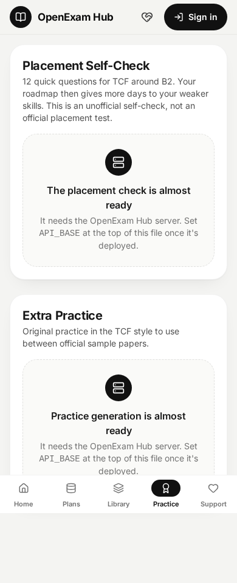

# OpenExam Hub

Free, official-source study roadmaps for language exams (TCF / DELF / DALF, IELTS, Goethe).
Pick an exam, a target level and a number of days and get a day-by-day plan. Every link comes
from an official exam board or public broadcaster, and the server checks it before you see it.
No paywalls, no accounts needed (anonymous by default, sign in to sync).

| Desktop | Mobile |
|---|---|
|  |  |
|  |  |

## What's inside

| Path | What it is |
|---|---|
| `index.html`, `src/` | Vite + React 18 + Tailwind 3 frontend. `src/App.jsx` is the whole app; `src/firebaseConfig.js` holds the public Firebase web config and the `VITE_*` overrides. |
| `api/` | Vercel Node 24 serverless functions (8 entrypoints; Hobby allows 12): `generate-roadmap`, `diagnostic`, `coach`, `practice`, plus dispatchers `[route].js` (check-link, library), `admin/[action].js`, `webhooks/[provider].js`, `cron/[job].js`. Route handlers live in `lib/routes/`; add new endpoints to a dispatcher, not as new `api/` files. |
| `lib/` | Server code: the orchestrator and agents (`lib/agents/`), the LLM client (`lib/llm.js`, any OpenAI-compatible gateway such as OmniRoute), the library store, ledger, link checker, and the pure algorithm layer (`lib/algo/`: ranking, scheduling, FSRS spaced repetition, adaptive placement, progress). |
| `scripts/` | Unit suites, the end-to-end test, the mock LLM, the local API server and the library seeder. |
| `firestore.rules`, `firestore.indexes.json`, `firebase.json`, `.firebaserc` | Firestore security rules and indexes for the `openexam-hub` Firebase project. |
| `vercel.json` | One Vercel project: Vite static build in `dist/`, functions in `api/`, SPA rewrite, daily 03:00 UTC link-recheck cron. |

Docs: [DEPLOY.md](DEPLOY.md) (env vars, Vercel, Firestore, webhooks, OmniRoute),
[CONTRACT.md](CONTRACT.md) (API contract), [ARCHITECTURE.md](ARCHITECTURE.md) (algorithms and data model).

## Run locally

```bash
npm install
npm run dev:api      # API on http://127.0.0.1:3001 (needs FIREBASE_SERVICE_ACCOUNT or FIRESTORE_EMULATOR_HOST, and LLM_* env)
npm run dev          # frontend on http://localhost:5173, /api proxied to :3001
```

Without a running API, build the UI in preview mode: `VITE_SERVER_ENABLED=false npm run dev`.

## Test

```bash
npm test             # offline unit suites: orchestrator, learner agents, ledger, algorithms
npm run e2e          # Firestore emulator (demo-openexam, needs Java 11+) + mock LLM + real HTTP to api/**
npm run build        # production frontend build into dist/
```

`npm run e2e` refuses any project id that does not start with `demo-`, so tests never touch the real project.

## Deploy

1. Import this repo in Vercel (root directory `./`). `vercel.json` sets the framework, build and output.
2. Add the server environment variables from [`.env.example`](.env.example) (see DEPLOY.md §1). Secrets go only into Vercel.
3. `firebase deploy --only firestore:rules,firestore:indexes` from the repo root.
4. Enable Anonymous, Email/Password and Google sign-in in Firebase Auth, and add the Vercel domain to Auth → Settings → Authorized domains.
